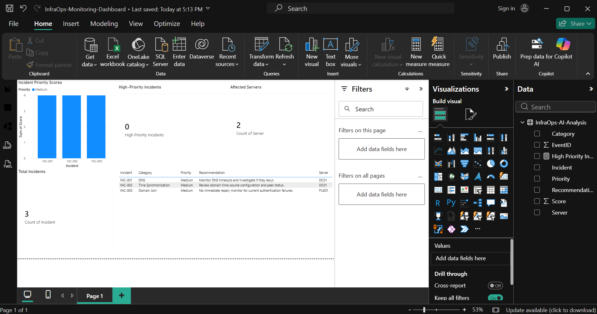

# InfraOps: AI-Powered Microsoft Infrastructure Monitoring

A hands-on infrastructure operations lab combining Windows Server administration, PowerShell automation, event-log analysis, rule-based incident assessment, and Power BI reporting.



## Overview

**InfraOps** is a local proof-of-concept designed to demonstrate how IT teams can collect infrastructure health information, investigate Windows events, prioritize incidents, and communicate findings through a dashboard.

The project uses a virtualized Microsoft environment and a PowerShell-based analysis engine to process a sample incident dataset and produce recommendations.

> **Project status:** Local prototype. Azure Monitor and Log Analytics integration is planned but not deployed. The current analysis uses predefined rules rather than a generative AI model.

## Architecture


flowchart TD
    A["Windows Infrastructure Lab<br/>Windows Server 2022 · Windows 11"] --> B["Active Directory · DNS · DHCP<br/>File Server · Domain Client"]

    B --> C["PowerShell Automation<br/>Inventory · Health Checks · Event Logs"]

    C --> D["Local Monitoring Data<br/>CSV · Windows Event Logs"]

    D --> E["Incident Dataset<br/>InfraOps-Incidents.json"]

    E --> F["PowerShell Incident Analysis<br/>Rule-Based Scoring & Recommendations"]

    F --> G["Analysis Outputs<br/>Text Report · CSV"]

    G --> H["Power BI Dashboard<br/>Incident KPIs · Priority Scores · Recommendations"]

    I["KQL Query Templates"] -. "Future integration" .-> J["Azure Monitor / Log Analytics<br/>Not deployed"]

    classDef infra fill:#DCEBFA,stroke:#3677B8,color:#16324F
    classDef analysis fill:#DDF3E4,stroke:#37865A,color:#17472B
    classDef output fill:#FBE8CE,stroke:#C98228,color:#633C0B
    classDef future fill:#EEEEEE,stroke:#888888,color:#333333

    class A,B infra
    class C,D,E,F analysis
    class G,H output
    class I,J future


1. **Infrastructure:** Windows Server 2022, Active Directory Domain Services, DNS, DHCP, a Windows file server, and a Windows 11 domain-joined client.
2. **Automation:** PowerShell scripts for Active Directory inventory, disabled-account reporting, and server health checks.
3. **Monitoring:** Windows event-log exports and a baseline summary across three lab systems.
4. **Incident analysis:** Rule-based incident scoring and recommendations for DNS, time synchronization, and domain-join findings.
5. **Visualization:** Power BI report with incident counts, priority scores, affected servers, and recommended actions.

## Technology Stack

- Windows Server 2022 and Windows 11
- Active Directory Domain Services
- DNS and DHCP
- PowerShell
- Windows Event Viewer and `Get-WinEvent`
- Power BI Desktop
- Kusto Query Language (KQL) templates for potential Azure Monitor / Log Analytics investigations
- VMware Workstation

## Sample Results

The current sample dataset contains three documented findings:

| Incident | System | Category | Priority |
|---|---|---|---|
| INC-001 | DC01 | DNS | Medium |
| INC-002 | DC01 | Time Synchronization | Medium |
| INC-003 | FILE01 | Domain Join | Medium |

The dashboard summarizes **3 sample incidents across 2 servers**, with **0 incidents classified as High priority** by the current analysis.

These are prototype results, not live production monitoring data.

## Repository Structure

```text
.
├── README.md
├── scripts/
│   ├── InfraOps-AI-Analysis.ps1
│   └── InfraOps-IncidentScoring.ps1
├── data/
│   └── sample/
│       └── InfraOps-Incidents.json
├── queries/
│   └── kql/
│       ├── InfraOps-TopEvents.kql
│       ├── InfraOps-SeveritySummary.kql
│       ├── InfraOps-DNS-TimeInvestigation.kql
│       ├── InfraOps-ServerComparison.kql
│       └── InfraOps-EventTimeline.kql
├── reports/
│   └── documentation/
│       ├── InfraOps-Monitoring-Baseline.txt
│       ├── InfraOps-Incident-Analysis.txt
│       ├── InfraOps-AI-Incident-Assessment.txt
│       └── InfraOps-Incident-Scoring.txt
└── dashboard/
    ├── InfraOps-Monitoring-Dashboard.pbix
    └── screenshots/
        └── InfraOps-Dashboard.png
```

*The file tree illustrates the intended layout. Confirm the exact filenames in GitHub and adjust this list if your uploaded names differ.*

## How to Explore the Project

1. Review `reports/documentation/InfraOps-Monitoring-Baseline.txt` for the monitoring baseline.
2. Review `data/sample/InfraOps-Incidents.json` for the sample incident records.
3. Explore `scripts/InfraOps-AI-Analysis.ps1` to understand the rule-based analysis and recommendation logic.
4. Browse `queries/kql/` for query templates.
5. View `dashboard/screenshots/InfraOps-Dashboard.png` or open the Power BI `.pbix` file in Power BI Desktop.

## Limitations and Future Work

- Incident assessment currently uses predefined PowerShell rules; it is not generative AI.
- The prototype processes local sample data rather than a live monitoring stream.
- KQL templates have not been validated against a live Log Analytics workspace.
- Azure Monitor integration, automated refresh, and advanced anomaly detection remain future enhancements.
- The incident scoring model can be refined with configurable weights and more validation scenarios.

## Disclaimer

This repository is intended for educational and portfolio use. The sample results are illustrative and should not be treated as production incident-response guidance. No credentials or sensitive infrastructure logs should be committed to the repository.
